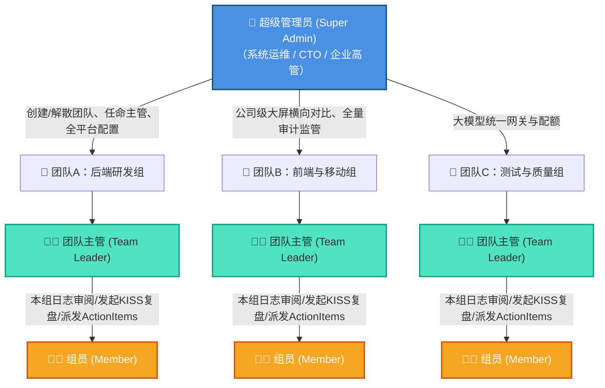
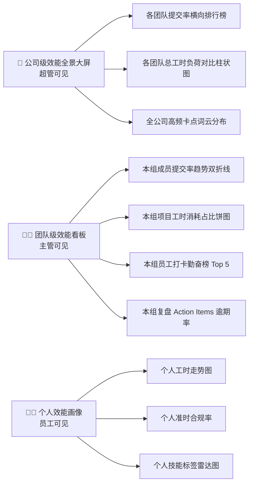

# 工作日志与智能复盘管理系统需求分析说明书（企业多团队最终定稿版）

## 1 文档概述
### 1.1 文档目的
本文档为**企业级工作日志与智能复盘管理系统（基于 Python + FastAPI + Vue3）**最终定稿需求分析说明书。系统采用**企业级多团队架构**，全面覆盖**多团队组织、三级权限颗粒度、复盘方法论模型、行级数据隔离、边界场景、异常处理、数据口径、算法与工程安全规范、验收标准**全维度内容。  
本文档为项目**系统架构设计、数据库建模、前后端开发、软件测试、毕业设计论文撰写与答辩验收**的唯一权威依据，杜绝口头需求与模糊定义。

### 1.2 项目背景与核心痛点
为解决现代企业内部多部门、多团队日常研发与协作管理中的核心痛点：
1. **跨团队规范不一与形式主义**：日志碎片化严重，仅用于出勤打卡，未关联具体团队、项目与任务，无法还原工作过程；
2. **多团队协同无统一标准**：缺少统一的企业级中台，各团队自立工具，缺乏平台级的统一安全审计与统一大模型基础设施配额管理；
3. **团队复盘成本高且流于形式**：周期性总结全靠手工翻找历史记录；复盘缺乏管理学方法论支撑，总结完后缺乏行动项追踪，导致“屡复屡犯”；
4. **企业管理层缺乏全局效能画像**：CTO/总经理无法横向对比各团队的交付饱和度、准时率及高频卡点；团队组长难以准确评估组员负荷；
5. **权限与数据无边界隔离**：缺乏细粒度的组织权限划分，跨组数据容易串扰泄密或误操作。

本系统旨在打造一套集**多团队组织管理、三级 RBAC 权限体系、规范化日志填报、附件深度鉴权、双向评论、版本历史快照、日志状态归档、AI多模型智能复盘（KISS/GRAI）、复盘行动项（Action Items）闭环、高频卡点聚类分析、多级效能大屏、双渠道通知、账号安全审计及移动端自适应**于一体的企业级数字化管理系统。

### 1.3 运行环境与技术选型
- **PC端运行环境**：Chrome 100+、Edge、Firefox 主流现代浏览器
- **移动端运行环境**：手机主流浏览器、企业微信内置移动浏览器（响应式H5）
- **前端架构**：**Vue 3 (Composition API, `<script setup>`) + Vite + Pinia + Vue Router 4 + Element Plus + ECharts**
- **后端架构**：**Python 3.10+ + FastAPI（全异步 async/await） + SQLAlchemy 2.0（异步 ORM） + Pydantic V2 数据校验**
- **异步任务与调度**：**Celery / Redis + APScheduler**（用于 LLM 大模型异步生成、每日漏填检查与定时推送）
- **数据存储**：
  - **MySQL 8.0**：持久化核心业务数据；原生 **JSON 数据类型** 支撑动态表单字段解耦与历史版本隔离；建立 `team_id` 外键与复合索引保障多团队数据隔离
  - **Redis 7.0**：用户 Token 鉴权缓存、密码防暴破计数器、大模型异步任务中间件与限流器
- **第三方与算法依赖**：兼容 OpenAI 标准协议的 LLM API（DeepSeek / Qwen / 通义千问等）、企业微信开放接口（Agent API & 群机器人 Webhook）、`python-docx`（标准化公文 Word 导出）、`jieba`（分词与高频卡点词频分析）

### 1.4 文档适用范围
适用于产品定义、系统架构、前后端编码、毕业设计开题报告及正文第 3 章（需求分析）撰写、软件工程验收测试。

---

## 2 系统组织架构、三级角色与权限体系
### 2.1 企业多团队组织层级模型
系统采用**“企业平台 $\rightarrow$ 业务团队（Teams） $\rightarrow$ 团队成员（Members）”**的经典二级组织层级结构，实现多团队平行协作与统一治理：



### 2.2 三级角色定义与核心职责
1. **超级管理员（Super Admin）**：
   - 平台最高权限掌控者，全局视角（上帝视角）；
   - 负责组织架构治理：创建业务团队、解散/归档团队、指派与变更团队主管；
   - 负责全平台基础设施配置：全局大模型 API Key 与模型路由配置、全局安全策略（密码有效期、防暴破阈值）、企业微信通讯录同步与推送总开关；
   - 查阅公司级宏观效能大屏（多团队交付横向比对）与全局不可篡改安全审计日志。
2. **团队主管 / 组长（Team Leader）**：
   - 业务单元核心管理者，数据范围严格限制在**所属团队内**；
   - 负责本组日常运维：审核新成员加入本团队的申请、管理本组岗位与业务标签；
   - 负责本组日志流转：审阅组员日志、打分评优、富文本批注、一键催交未交组员、批量归档导出本组日志；
   - 负责本组复盘沉淀：定期发起团队级智能复盘（KISS/GRAI）、确认并向组员派发改进项（Action Items）、跟进任务进度；
   - 查看本团队效能大屏（组员工时热力、高频卡点词云、准时率排行）。
3. **普通员工（Member）**：
   - 团队基层执行者，数据范围仅限**个人业务范畴**；
   - 日常业务操作：填报与编辑个人工作日志、上传附件、查看并回复主管批注、发起个人周报初稿生成与人工定稿；
   - 任务改进闭环：认领执行被主管派发的 Action Items 并打勾更新状态；
   - 查看个人效能画像（个人准时率、个人工时走势图）。

### 2.3 跨团队数据隔离与向下穿透规则（答辩核心亮点）
1. **行级数据隔离（Row-Level Security）**：
   - 团队主管与组员的所有业务查询，后端通过当前登录用户的 `current_user.team_id` 自动进行 SQL 拦截过滤；
   - **主管绝对无法越权窥探或修改兄弟团队的日志、复盘与统计数据**，确保团队间业务保密性。
2. **超管垂直向下穿透**：
   - 超级管理员具备跨团队穿透权限，可通过前端下拉框自由切换查看指定团队的日志与复盘，亦可在公司大屏中并排比对各团队数据。
3. **账号归属约束**：
   - 普通账号在同一时间仅归属一个团队，支持由超级管理员执行“转组/调动”操作（调动后保留原团队历史日志归属，新日志绑定新团队）。

### 2.4 用户账号全状态机（互斥状态）
1. `PENDING_REVIEW`（待审核）：新自主注册账号，需选择意向团队，由该团队主管或超管审批后方可登录；
2. `ACTIVE`（正常启用）：账号可用，享有角色对应的全量操作权限；
3. `DISABLED`（账号禁用）：管理员手动停用，禁止登录；
4. `LOCKED`（密码锁定）：连续输错密码触发阈值，进入防暴力破解保护锁定期；
5. `PASSWORD_EXPIRED`（密码过期）：超出配置的密码有效期，登录后强制跳转修改密码页，不可访问任何业务 API。

### 2.5 管理员防自锁死与超级特权保护
- **Root 账号特权豁免**：系统初始化生成唯一的超级特权账号 `root`（属于超级管理员角色），业务逻辑上**免疫锁定与禁用**，杜绝系统因管理员误操作锁死而瘫痪。
- **CLI 救砖工具**：后端提供终端运维管理脚本（`python -m app.cli unlock-admin --username admin`），无需进入 Web 界面即可在服务器控制台重置超管密码并恢复状态。

### 2.6 三级角色权限细粒度矩阵
| 模块/功能点 | 👑 超级管理员 (Super Admin) | 👨‍💼 团队主管 (Team Leader) | 👨‍💻 普通员工 (Member) |
| :--- | :---: | :---: | :---: |
| 团队创建 / 解散 / 主管任命 | ✅ | ❌ | ❌ |
| 本组成员入组审批 / 角色变更 | ✅ | ✅ (仅限本组) | ❌ |
| 重置员工密码 / 解锁账号 | ✅ (全员) | ✅ (仅限本组成员) | ❌ |
| 全局系统底座配置 (LLM / 企微) | ✅ | ❌ | ❌ |
| 团队标签维护 (项目/技术分类) | ✅ | ✅ (仅限本组) | ❌ (仅选择) |
| 日志填报 / 编辑 / 补交 | ✅ | ✅ | ✅ |
| 日志审阅打分 / 富文本批注 | ✅ (全量) | ✅ (仅限本组) | ❌ (仅回复) |
| 日志一键催交 / 批量归档导出 | ✅ (跨组) | ✅ (仅限本组) | ❌ |
| 发起团队复盘 (KISS/GRAI) | ✅ (全团队) | ✅ (仅限本组) | ❌ (仅发起个人周报) |
| 派发与跟踪复盘 Action Items | ✅ | ✅ (指派本组组员) | ✅ (仅执行被派发任务) |
| 效能分析大屏查看 | ✅ (公司级全景对比大屏) | ✅ (团队级效能看板) | ✅ (仅个人效能画像) |
| 全局安全审计日志与导出 | ✅ | ❌ | ❌ |

---

## 3 全局通用规则与数据边界
### 3.1 数据持久化与软状态变更
1. 系统所有业务数据（团队信息、日志、附件记录、版本快照、复盘周报、行动项、评论、审计记录）**一律永久持久化存储**。
2. 系统**严禁任何形式的后台静默物理删除（Hard Delete）**。团队解散采用 `is_archived = True` 软归档，人员离职采用禁用，日志使用状态机流转，确保历史记录可 100% 留痕审计。

### 3.2 统一响应体与异常分层规范
1. **RESTful 标准响应格式**：所有接口均返回统一结构体：
   ```json
   {
     "code": 200,
     "message": "success",
     "data": { ... },
     "timestamp": 1773288900
   }
   ```
2. **安全脱敏与报错隔离**：任何后端未捕获异常或 SQL 异常均由统一全局异常拦截器（Exception Handler）拦截，向前端返回标准中文业务提示，**绝对禁止暴露数据库堆栈与服务器敏感路径**。

### 3.3 时间基准与工作日判定口径
1. 系统所有定时任务与业务判断以**统一业务时区（如 GMT+8）**为基准，不依赖物理宿主机时区。
2. 基础统计中的“应提交工作日”以周一至周五为自然工作日，并支持管理员在后台节假日配置表中标记调休与法定节假日，保证多团队横向对比的公允性。

---

## 4 账号安全、鉴权与登录模块
### 4.1 双登录接入模式
1. **账号密码登录**：核心认证方式，基于 JWT（JSON Web Token）实现无状态鉴权。
2. **企业微信扫码/授权登录**：支持 OAuth2.0 扫码，绑定企微 `userid` 后实现免密快捷登入；未开启企微时不影响账密体系独立运行。

### 4.2 注册审核与团队归属流转
1. 注册信息包括：用户名、真实姓名、密码、手机号/邮箱、**意向加入团队**。
2. 注册提交后状态置为 `PENDING_REVIEW`，对应团队主管及超级管理员的通知中心收到“新成员待审批通知”。
3. 团队主管或超管操作：【通过】置为 `ACTIVE`；【驳回】置为 `REJECTED` 并记录驳回理由。
4. 被驳回账号可修改资料重新提交；所有审核与驳回动作全量落入审计日志。

### 4.3 密码强度、防重与生命周期管理
1. **密码复杂度**：长度不少于 8 位，且必须同时包含“大写字母、小写字母、数字”（特殊字符可选）。
2. **加盐哈希**：后端密码采用 **Argon2 或 BCrypt** 算法加盐单向加密，数据库不存任何明文字段。
3. **密码有效期强制改密**：超管可在后台配置有效天数（默认 90 天，0 为永久）。过期登录时强制重定向至修改密码页。
4. **【安全防重约束】**：用户修改密码时，系统必须比对**最近 3 次使用过的历史哈希记录**，严禁重复使用近 3 次内的旧密码。

### 4.4 登录防暴力破解机制
1. 超管可配置防暴破参数：最大连续失败次数（默认 5 次）、临时锁定时长（默认 15 分钟，设为 0 表示永久锁定需主管/超管手动解锁）。
2. 失败计数依托 Redis 高性能原子自增，并在触发锁定时代写 MySQL 状态，保证高并发下防刷且重启不丢失。
3. 登录成功自动重置清零错误计数器。

### 4.5 会话与多端协同
1. 访问令牌（Access Token，有效时长 2 小时）与刷新令牌（Refresh Token，有效时长 7 天）双 Token 机制。
2. 允许单账号多端（PC + 移动端 H5）同时在线办公。
3. 客户端连续 30 分钟无操作自动超时登出，主动登出时将当前 Token 加入 Redis 黑名单直至过期。

---

## 5 通知中心（站内与企业微信双渠道集成）
### 5.1 渠道分层与容灾策略
1. **站内通知中心（核心兜底）**：持久化于 MySQL，所有业务事件（审阅打分、催交、AI生成完毕、行动项指派）必发站内信。
2. **企业微信外部推送（增强渠道）**：
   - 支持**企业微信官方应用消息（Agent API）**与**企业微信群机器人 Webhook** 双模式（群机器人模式免去企业主体认证门槛，便于答辩离线展示）；
   - 提供**通知沙箱开关**：开发与答辩断网环境下可开启沙箱，模拟推送成功并直接在后台“推送日志”中预览 Markdown 卡片渲染效果。

### 5.2 业务通知触发场景与独立开关
超管与团队主管可针对本团队独立控制以下开关与推送时段：
1. **每日下班前日志填报提醒**（如每个工作日 17:30 触达未交员工）；
2. **每日漏填/迟交告警汇总**（如每个工作日 19:00 汇总推送至对应团队主管）；
3. **日志审阅打分与评论互动通知**（即时触达日志所有者）；
4. **AI 智能复盘生成成功/失败通知**（异步任务结束即时推送）。

---

## 6 日志管理核心模块（业务基石）
### 6.1 动态字段配置与历史隔离架构（MySQL JSON 实现）
1. **基础业务字段**：
   - `team_id`：所属团队 ID（数据隔离核心外键）
   - `log_date`：工作归属日期（年月日）
   - `today_completed`：今日工作成果与产出
   - `blockers`：遇到的问题与阻碍点（卡点）
   - `tomorrow_plan`：明日或后续工作计划
   - `spent_hours`：实际工时耗时统计
   - `tag_ids`：关联的工作/技术标签列表
2. **动态配置规则**：主管与超管可在后台配置字段的“启用/隐藏”及“是否必填”。
3. **【核心历史隔离机制】**：日志内容实体表采用 `content_json`（MySQL JSON 字段）存储提交瞬间的完整键值对快照。后续调整字段配置，**历史旧日志的展示排版与字段结构 100% 保持不变**，仅新保存日志生效最新配置。

### 6.2 填报时效与“迟交/补交”业务边界（严格闭环）
1. **严禁未来预交**：业务逻辑严密校验 `log_date <= 当前自然日期`，严禁提前预填未来工作日志。
2. **限期补交与迟交判定**：
   - 允许员工补交过去最多 7 天内遗漏的日志；
   - **准时与迟交判定标准**：日志初次提交时间 `created_at > log_date 当日 23:59:59` 即自动标记为 `is_delayed = True`（迟交/补交）；
   - 数据统计看板中独立核算“准时提交率”与“补交率”，既保障团队过程追溯的灵活性，又彻底杜绝月底集中突击刷假打卡。

### 6.3 附件安全与深度校验体系
1. **白名单格式**：图片类（`.jpg`, `.png`, `.gif`）、文档类（`.pdf`, `.docx`, `.xlsx`）。
2. **【文件魔数深度校验（防伪装木马）】**：后端严禁仅校验文件后缀名，必须采用 `python-magic` 库比对文件二进制文件头（Magic Bytes）；针对伪装成 `.jpg` 的可执行脚本（`.php`, `.sh`, `.exe`, `.bat`）直接抛出安全异常拦截。
3. **存储与防覆盖**：上传文件在服务器统一采用 `UUID4 + 原始扩展名` 重命名存储，杜绝路径穿越与同名覆盖。
4. **下载鉴权流式分发**：附件不开放 Web 静态目录直链访问，一律通过后端鉴权路由 `/api/v1/attachments/{id}/download` 进行 Session 权限验证后通过流式（StreamingResponse）安全传输。
5. **容量上限**：单文件最大 20MB，单篇日志最多支持 10 个附件。

### 6.4 双向一级评论与归档交互
1. **评论层级**：采用清晰的一级评论互动模式，支持主管点评打分与员工自身回复。
2. **权限隔离**：团队主管仅可评论本团队员工日志，员工仅可评论个人日志，超管可跨组视察评论。
3. **永久留存规则**：评论一经发表，任何人不可删除，确保评价具备管理法律效力。
4. **归档状态下的评论开放性**：日志归档后，虽然**文本正文与附件永久冻结只读**，但**评论互动区依然保持开放**，允许团队针对历史已归档事项进行持续的回溯讨论。

### 6.5 版本快照与版本回滚机制
1. **快照生成**：每次员工点击【提交修改】时，若正文内容有变动，系统自动在 `work_log_versions` 表生成一条不可变快照记录，存储版本号、操作人、修改时间、变更字段 JSON 及版本摘要。
2. **版本对比与一键回滚**：前端提供类似 Git 差异比对的可视化视图；主管或员工可选择历史任一版本执行【回滚】。回滚操作本质上是**读取历史快照内容作为最新版本重新插入**，历史快照链路永不截断。

### 6.6 日志批量归档与 Excel 结构化导出
1. **归档操作**：主管可按时间段对本组日志批量归档，归档后状态置为 `ARCHIVED`。
2. **批量导出**：主管可导出本组台账，超管可导出全公司汇总台账 Excel。导出内容包含：团队名、员工姓名、工号、日期、各项工作内容、附件清单、评论列表及版本修改次数；导出操作全量记入审计日志。

---

## 7 团队业务标签管理模块
1. **标签归属隔离**：标签支持“全局公共标签（超管维护）”与“团队专属标签（主管维护）”，满足不同项目组个性化打标需求（如：算法组打标“模型训练”，前端组打标“页面重构”）。
2. **生命周期与删除约束**：仅主管/超管有权新建与禁用标签；已被历史日志绑定的标签**严禁物理删除**，仅可置为【禁用】。被禁用的标签在历史日志中正常渲染，但在新日志填报下拉框中置灰不可选。

---

## 8 智能复盘与周报核心引擎（⭐ 毕设学术与技术核心）
### 8.1 团队级复盘 vs 个人周报双模式
系统支持两种层级的智能总结：
1. **个人周报模式（员工发起）**：针对个人在特定周期（7~14天）内的碎片日志，总结个人工作产出、卡点及下周计划；
2. **团队周期复盘模式（主管/超管发起）**：汇聚**本团队全体成员**在特定周期内的所有日志，结合管理学模型进行团队级全局深度复盘。

### 8.2 经典复盘方法论模型（避免单一流水账总结）
系统拒绝“简单的调用大模型写流水账周报”，在提示词工程（Prompt Engineering）中固化内嵌经典管理学模型：
1. **KISS 复盘模型**：
   - **Keep（保持）**：本周期内团队高质效、值得标准化的良好实践与工作成果；
   - **Improve（改进）**：本周期内暴露出的流程低效、交付拖延与有待改进项；
   - **Start（启动）**：应对当前卡点，下周期应立即启动的新技术、新工具或新措施；
   - **Stop（停止）**：应立即叫停的无效内耗、重复性低产出动作。
2. **GRAI 复盘模型**：
   - **目标回顾**：周期初设定的任务与计划目标；
   - **结果比对**：实际交付成果与初始目标的客观偏差；
   - **过程审视**：导致正向超预期或负向延期的关键因果归因；
   - **规律总结**：沉淀出团队可复用的经验法则与避坑指南。

### 8.3 复盘行动项（Action Items）闭环跟踪机制
1. **AI 智能提炼**：大模型生成复盘报告的同时，系统要求其输出标准的结构化 Action Items JSON 数组（包含：改进事项名称、具体落地举措、建议责任人、交付截止日期、验证标准）。
2. **任务化流转与状态跟进**：主管审阅确认后，可一键将提炼出的 Action Items 派发给本组对应员工；系统建立独立的行动项追踪看板（待处理 $\rightarrow$ 进行中 $\rightarrow$ 已完成 $\rightarrow$ 已逾期），并在下一次周复盘时自动比对完成度，形成管理闭环。

### 8.4 长文本分块压缩机制（Map-Reduce 机制，防 Token 溢出）
1. **时间跨度约束**：单次发起复盘的时间区间**最大限制为 31 天**，防止无节制长文本消耗。
2. **Map-Reduce 分段提炼策略**：
   - 若周期内多人日志汇总字符量 $\le 6000$ 字，直接装配模板调用 LLM 综合生成；
   - 若汇总字符量 $> 6000$ 字（多人长周期日志），后台触发 Map-Reduce 算法管道：先按员工/按天为单元切片并行提炼核心产出与 Blocker（Map 阶段），再将提炼后的摘要汇总拼装，送入大模型生成最终复盘报告（Reduce 阶段），彻底解决大模型 Context Window 溢出与接口超时崩溃问题。

### 8.5 阻碍点（Blocker）词频与聚类分析（轻量算法支撑）
- 后端集成 Python 中文分词库 `jieba` 与 TF-IDF 关键词抽取算法。
- 定期对本团队或全公司员工日志中的“遇到问题/卡点”字段进行分词清洗、停用词过滤，提取出 Top 10 高频技术阻碍关键词（如：接口联调、数据库慢查、依赖冲突、需求变更），生成词云和聚类频次图，为答辩提供坚实的算法与数据处理工作量。

### 8.6 异步任务状态机与流式体验
1. **状态流转**：`QUEUED`（排队中） $\rightarrow$ `PROCESSING`（生成中） $\rightarrow$ `SUCCESS`（成功） / `FAILED`（失败）。
2. **无阻塞体验**：采用 Celery / 后台异步协程处理，任务下发后返回 `task_id`，前端支持轮询或通过 SSE（Server-Sent Events）实现打字机效果预览生成过程。单次 LLM 超时阈值设为 45 秒，失败支持自动重试 1 次。

### 8.7 周报双版本管理与规范导出
1. **AI初稿 vs 人工定稿**：AI 生成内容持久化为“系统初稿”（不可编辑，用于比对大模型效果）；系统自动复制一份生成“人工定稿”，员工可在富文本编辑器中针对性补充、修正，主管最终查阅以定稿为准。
2. **Word / Markdown 标准化导出**：
   - 采用 `python-docx` 库在服务端按红头公文排版规范渲染生成 Word 文档，内置企业标头、双栏表格与 Action Items 表；
   - 导出文件严格遵循命名规范：`【复盘报告】团队名_姓名_起止日期_模型名.docx`。

---

## 9 多级效能分析与可视化大屏（PC 专属）
### 9.1 三级看板视图划分
为适配三级角色需求，大屏划分为三种视图：



### 9.2 核心统计口径定义
1. **自然工作日（$D_{work}$）**：统计区间内去除周末及法定节假日的标准工作日天数。
2. **应提交人次数（$N_{should}$）**：团队在职正常员工数 $\times D_{work}$。
3. **准时提交数（$N_{on\_time}$）**：`created_at <= log_date 23:59:59` 且有效提交的日志总数。
4. **迟交/补交数（$N_{delay}$）**：`created_at > log_date 23:59:59` 的补交有效日志数。
5. **准时提交合规率**：$\frac{N_{on\_time}}{N_{should}} \times 100\%$。
6. **团队综合补全率**：$\frac{N_{on\_time} + N_{delay}}{N_{should}} \times 100\%$。

---

## 10 全局审计日志模块（安全与合规）
1. **审计记录边界**：覆盖登录（成功/失败/锁定/登出）、账号审批与密码重置、团队创建与主管任命、敏感配置修改（LLM Key、企微 Secret）、日志批量归档与 Excel 导出、版本回滚、复盘报告生成全流程。
2. **严格只读与不可篡改**：审计数据在数据库中只增不改，任何角色（包括 Admin）均无权限编辑或删除审计记录。
3. **敏感信息脱敏**：记录大模型 Key、企业微信凭证变更时，明文凭证强制脱敏为类似 `sk-ab***123` 掩码形式落盘。
4. **审计详情字段**：`id`, `team_id`, `operator_id`, `operator_name`, `action_type`, `resource_target`, `ip_address`, `user_agent`, `status`, `extra_json`, `created_at`。

---

## 11 移动端 H5 适配规范
### 11.1 核心支持范围（保障掌上办公）
1. 移动端快捷登录（账密登录与移动端企微静默/授权绑定）。
2. 今日日志填报、修改、拍照上传附件。
3. 审阅列表查看、批注回复、评论即时推送查看。
4. 个人周报与智能复盘任务的发起、查看与 Markdown 文本复制。
5. 个人待办复盘行动项（Action Items）的状态打勾流转。

### 11.2 明确不支持功能（端职责分离）
1. 团队多维效能可视化大屏（图表密集，仅限 PC 呈现）。
2. 全局后台系统配置与字段模板设计。
3. 团队组织管理与跨团队人员调配。
4. 日志批量归档与团队级 Excel 大台账导出。
5. 全量操作审计日志检索。

---

## 12 非功能性与工程质量要求
### 12.1 性能指标
1. **常规接口性能**：在 10 万级日志基数下，带团队过滤与分页的列表查询后端响应时间 $\le 300\text{ms}$。
2. **首屏渲染性能**：PC 端与移动端 H5 生产环境构建后，首屏资源加载与渲染完成时间 $\le 1.5\text{s}$。
3. **高并发与限流**：单机部署状态下支持 50+ 客户端并发填报无报错；大模型复盘任务基于 Redis 信号量限制全局并发数 $\le 10$，多余任务平滑进入队列排队等待。

### 12.2 数据备份与容灾恢复
1. 后端提供定时数据库 Dump 备份脚本，每日凌晨对 MySQL 执行逻辑冷备并生成压缩包。
2. 历史备份文件按滚动周期保留 30 天，支持一键下载恢复。

---

## 13 预置演示数据体系（答辩专属加分项）
系统内置完整的多团队数据初始化脚本（`python -m app.cli init-data`），一键拉起逼真的企业多团队运行环境：
1. **多团队组织架构**：
   - 团队 1：`后端研发组`（主管：`manager_backend`，组员：`dev_zhang`, `dev_li`）
   - 团队 2：`前端研发组`（主管：`manager_frontend`，组员：`dev_wang`, `dev_zhao`）
   - 团队 3：`测试质保组`（主管：`manager_qa`，组员：`qa_liu`）
2. **特权账号体系**：
   - 超级管理员：`root / Root@123456`（拥有全公司上帝视角，查看三组横向对比）
3. **业务周期数据**：预置 3 个团队过去 4 周（20 个工作日）的交错日志流，展示不同团队间不同的提交率与工作负荷差异。
4. **智能复盘成果**：预置基于 KISS 模型生成的团队复盘定稿，包含 8 条处于不同生命周期的 Action Items。
5. **三级大屏显现**：开箱即呈现超管端的多团队横向排行榜、主管端的本组工时饼图与卡点词云、员工端的个人画像。

---

## 14 项目验收标准矩阵
| 验收维度 | 验收标准合格线 |
| :--- | :--- |
| **功能完整性** | 本文档定义的 15 个功能章节 100% 编码实现，支持三级角色与多团队业务流转，无接口 500 堆栈抛出。 |
| **技术栈一致性** | 后端完全基于 Python 3.10+ & FastAPI 异步架构，前端完全基于 Vue 3 + Pinia + Vite，无技术栈冲突。 |
| **多团队数据隔离** | 严格行级数据隔离，主管只能查看本组数据；超管具备全局穿透与横向比对能力。 |
| **业务逻辑闭环** | 达成“日志填报 $\rightarrow$ 审核批注 $\rightarrow$ AI 智能复盘（KISS/GRAI） $\rightarrow$ 行动项落地跟踪”的完整闭环。 |
| **安全防御合规** | 密码加盐哈希防重；管理员防自锁死保护生效；附件通过二进制魔数拦截可执行恶意文件；权限鉴权无水平越权漏洞。 |
| **答辩演示体验** | 一键执行初始化脚本拉起逼真多团队演示数据；移动端适配流畅自适应；周报支持标准 Word 与 Markdown 导出。 |

---

## 15 业务规则最终定稿收口
1. **团队隔离红线**：所有业务查询必须强制携带 `team_id` 过滤（超管穿透模式除外），杜绝越权访问其他团队日志。
2. **归档权限红线**：日志一旦归档，**正文内容与附件永久锁定禁改**，但评论互动区允许持续发言追溯。
3. **复盘数据红线**：所有生成的复盘与周报记录永久入库留痕，任何角色均不可删除。
4. **动态字段红线**：基于 MySQL JSON 列存储，后台修改字段配置**绝不污染或重置历史旧日志结构**。
5. **标签生命周期**：已关联历史日志的标签**严禁物理删除**，仅支持禁用。
6. **安全保护红线**：`root` 超级特权账号永不锁定，保证系统永远具备后台运维入口。
