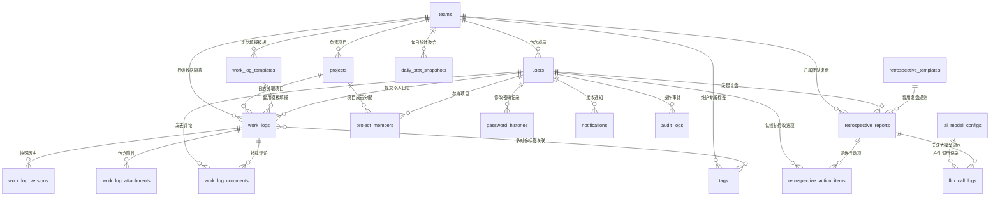

# 团队工作日志与智能复盘管理系统 —— 数据库设计说明书与 DDL 脚本（企业高扩展版）

## 1 数据库设计规范与原则
1. **数据库引擎与字符集**：
   - 存储引擎：全量采用 **InnoDB**（支持行级锁、ACID 事务与外键约束）；
   - 字符集与排序规则：**`utf8mb4`** / **`utf8mb4_unicode_ci`**（全面支持 Emoji、特殊技术符号及多国语言，不出现中文乱码）。
2. **命名与设计规范**：
   - 表名采用小写蛇形复数命名（如 `work_logs`, `audit_logs`）；
   - 主键统一采用 `id BIGINT UNSIGNED AUTO_INCREMENT PRIMARY KEY`，具备超大容量支撑能力；
   - 每一张物理表均标配：`created_at DATETIME NOT NULL DEFAULT CURRENT_TIMESTAMP` 与 `updated_at DATETIME NOT NULL DEFAULT CURRENT_TIMESTAMP ON UPDATE CURRENT_TIMESTAMP` 审计时间戳；
   - 逻辑删除与状态变更：全面采用 `is_active` / `is_archived` 或状态机枚举（`status`），杜绝物理硬删除。
3. **高扩展性支撑策略**：
   - 动态字段：日志填报正文使用 **MySQL 8.0 原生 `JSON`** 列存储，天然支持历史版本隔离；
   - 大屏高并发：引入 **`daily_stat_snapshots`（每日效能快照表）**，将 ECharts 复杂分组计算降至毫秒级单表读取；
   - 行级多团队隔离：所有团队关联表强制建立 `team_id` 外键与复合索引。

---

## 2 数据库实体概念模型 (E-R Diagram)



---

## 3 完整数据表字典清单（22 张高扩展表）

| 序号 | 表名 (`table_name`) | 中文名称 | 所属业务域 | 核心职责说明 |
| :---: | :--- | :--- | :--- | :--- |
| 1 | `teams` | 团队组织表 | 组织权限域 | 维护业务团队实体，支持主管任命与多团队隔离 |
| 2 | `users` | 用户账号表 | 组织权限域 | 三级 RBAC、5 种互斥状态、`is_root` 防锁死 |
| 3 | `password_histories` | 历史密码表 | 组织权限域 | 记录密码历史加盐哈希，强制校验近 3 次防重复 |
| 4 | `projects` | 企业项目表 | 项目协作域 | 独立项目实体，生命周期、起止日期与进度 |
| 5 | `project_members` | 项目成员表 | 项目协作域 | 支撑跨团队人员参与项目的多对多映射 |
| 6 | `work_calendars` | 节假日与工作日历表 | 规则日历域 | 法定节假日与调休排班，保障提交率判定精确无误 |
| 7 | `work_log_templates` | 日志表单模板表 | 日志核心域 | 研发/测试/通用模板，基于 JSONSchema 驱动 |
| 8 | `work_logs` | 工作日志主表 | 日志核心域 | 核心业务表，JSON 动态字段、迟交标记、归档状态 |
| 9 | `work_log_versions` | 日志版本快照表 | 日志核心域 | 保存不可变编辑快照，支持无损版本比对与回滚 |
| 10 | `work_log_attachments`| 日志附件表 | 日志核心域 | 存储 UUID 随机文件名、二进制文件魔数 MIME 校验 |
| 11 | `work_log_comments` | 双向一级评论表 | 日志核心域 | 扁平评论互动、永久留存不可删、归档后仍开放 |
| 12 | `tags` | 业务/技术标签表 | 日志核心域 | 支持全公司公共标签与团队专属标签，仅支持软禁用 |
| 13 | `work_log_tag_rel` | 日志-标签关联表 | 日志核心域 | 日志与多标签的多对多解耦桥接表 |
| 14 | `ai_model_configs` | AI 模型网关配置表 | 智能复盘域 | 热插拔动态配置 DeepSeek/Qwen/GPT/Ollama |
| 15 | `retrospective_templates`| 复盘方法论模板表 | 智能复盘域 | 内置 KISS、GRAI 及自定义复盘 Prompt 模板 |
| 16 | `retrospective_reports`| 智能复盘报告表 | 智能复盘域 | 团队/个人双模式、AI 初稿 vs 人工定稿双版本 |
| 17 | `retrospective_action_items`| 复盘行动项闭环表| 智能复盘域 | 提炼结构化改进任务，状态看板流转与执行凭据 |
| 18 | `llm_call_logs` | AI 调用与 Token 审计表| 智能复盘域 | 监控每次大模型调用的耗时、Token 消耗与成本 |
| 19 | `daily_stat_snapshots`| 每日效能聚合快照表 | 性能大屏域 | 每日凌晨离线预计算，保障大屏毫秒级秒开 |
| 20 | `system_configs` | 全局参数配置表 | 系统底座域 | 企微 Webhook、密码策略、安全参数页面化配置 |
| 21 | `notifications` | 双渠道通知中心表 | 系统底座域 | 站内信未读红点 + 企微推送与沙箱预览 |
| 22 | `audit_logs` | 全局安全审计日志表 | 系统底座域 | 永久只增不改，包含 IP、UA、敏感操作全脱敏留痕 |

---

## 4 可直接执行的 MySQL 8.0 DDL 完整建表脚本

您可以直接将以下 SQL 导入 MySQL 8.0 执行：

```sql
-- ====================================================================
-- 数据库初始化脚本：团队工作日志与智能复盘管理系统 (MySQL 8.0+)
-- 字符集：utf8mb4  排序规则：utf8mb4_unicode_ci
-- ====================================================================

CREATE DATABASE IF NOT EXISTS `end_design_db` 
  DEFAULT CHARACTER SET utf8mb4 
  DEFAULT COLLATE utf8mb4_unicode_ci;

USE `end_design_db`;

SET FOREIGN_KEY_CHECKS = 0;

-- --------------------------------------------------------------------
-- 1. 团队组织表 (teams)
-- --------------------------------------------------------------------
DROP TABLE IF EXISTS `teams`;
CREATE TABLE `teams` (
  `id` BIGINT UNSIGNED NOT NULL AUTO_INCREMENT COMMENT '团队主键ID',
  `name` VARCHAR(64) NOT NULL COMMENT '团队名称 (如: 后端研发组)',
  `code` VARCHAR(32) NOT NULL COMMENT '团队唯一编码 (如: TEAM_BACKEND)',
  `leader_id` BIGINT UNSIGNED DEFAULT NULL COMMENT '团队主管用户ID',
  `description` VARCHAR(255) DEFAULT NULL COMMENT '团队职责描述',
  `is_active` TINYINT(1) NOT NULL DEFAULT 1 COMMENT '是否正常启用 (1:启用, 0:停用)',
  `created_at` DATETIME NOT NULL DEFAULT CURRENT_TIMESTAMP COMMENT '创建时间',
  `updated_at` DATETIME NOT NULL DEFAULT CURRENT_TIMESTAMP ON UPDATE CURRENT_TIMESTAMP COMMENT '更新时间',
  PRIMARY KEY (`id`),
  UNIQUE KEY `uk_teams_code` (`code`),
  KEY `idx_teams_leader` (`leader_id`)
) ENGINE=InnoDB DEFAULT CHARSET=utf8mb4 COLLATE=utf8mb4_unicode_ci COMMENT='团队组织表';

-- --------------------------------------------------------------------
-- 2. 用户账号表 (users)
-- --------------------------------------------------------------------
DROP TABLE IF EXISTS `users`;
CREATE TABLE `users` (
  `id` BIGINT UNSIGNED NOT NULL AUTO_INCREMENT COMMENT '用户主键ID',
  `team_id` BIGINT UNSIGNED DEFAULT NULL COMMENT '归属团队ID (超管可为空)',
  `username` VARCHAR(64) NOT NULL COMMENT '登录账号名',
  `hashed_password` VARCHAR(255) NOT NULL COMMENT '加盐加密密码 (Argon2/BCrypt)',
  `real_name` VARCHAR(64) NOT NULL COMMENT '真实姓名',
  `email` VARCHAR(128) DEFAULT NULL COMMENT '邮箱',
  `phone` VARCHAR(32) DEFAULT NULL COMMENT '联系手机号',
  `avatar_url` VARCHAR(255) DEFAULT NULL COMMENT '头像地址',
  `role` ENUM('SUPER_ADMIN', 'TEAM_LEADER', 'MEMBER') NOT NULL DEFAULT 'MEMBER' COMMENT '三级角色: 超级管理员/团队主管/普通员工',
  `status` ENUM('PENDING_REVIEW', 'ACTIVE', 'DISABLED', 'LOCKED', 'PASSWORD_EXPIRED') NOT NULL DEFAULT 'PENDING_REVIEW' COMMENT '账号互斥状态机',
  `is_root` TINYINT(1) NOT NULL DEFAULT 0 COMMENT '是否为Root超级特权账号 (1:豁免锁定与禁用)',
  `failed_login_attempts` INT NOT NULL DEFAULT 0 COMMENT '连续输错密码次数',
  `locked_until` DATETIME DEFAULT NULL COMMENT '密码锁定解除时间点',
  `password_changed_at` DATETIME NOT NULL DEFAULT CURRENT_TIMESTAMP COMMENT '最后改密时间 (用于判断过期)',
  `wechat_userid` VARCHAR(64) DEFAULT NULL COMMENT '绑定的企业微信成员ID',
  `created_at` DATETIME NOT NULL DEFAULT CURRENT_TIMESTAMP COMMENT '创建时间',
  `updated_at` DATETIME NOT NULL DEFAULT CURRENT_TIMESTAMP ON UPDATE CURRENT_TIMESTAMP COMMENT '更新时间',
  PRIMARY KEY (`id`),
  UNIQUE KEY `uk_users_username` (`username`),
  KEY `idx_users_team` (`team_id`),
  KEY `idx_users_status` (`status`),
  KEY `idx_users_role` (`role`),
  CONSTRAINT `fk_users_team` FOREIGN KEY (`team_id`) REFERENCES `teams` (`id`) ON DELETE SET NULL
) ENGINE=InnoDB DEFAULT CHARSET=utf8mb4 COLLATE=utf8mb4_unicode_ci COMMENT='用户账号表';

-- 回填 teams 表的 leader_id 外键
ALTER TABLE `teams` 
  ADD CONSTRAINT `fk_teams_leader` FOREIGN KEY (`leader_id`) REFERENCES `users` (`id`) ON DELETE SET NULL;

-- --------------------------------------------------------------------
-- 3. 历史密码表 (password_histories - 防近3次重复)
-- --------------------------------------------------------------------
DROP TABLE IF EXISTS `password_histories`;
CREATE TABLE `password_histories` (
  `id` BIGINT UNSIGNED NOT NULL AUTO_INCREMENT COMMENT '主键ID',
  `user_id` BIGINT UNSIGNED NOT NULL COMMENT '用户ID',
  `hashed_password` VARCHAR(255) NOT NULL COMMENT '历史密码加盐哈希',
  `created_at` DATETIME NOT NULL DEFAULT CURRENT_TIMESTAMP COMMENT '记录时间',
  PRIMARY KEY (`id`),
  KEY `idx_pwd_user` (`user_id`),
  CONSTRAINT `fk_pwd_user` FOREIGN KEY (`user_id`) REFERENCES `users` (`id`) ON DELETE CASCADE
) ENGINE=InnoDB DEFAULT CHARSET=utf8mb4 COLLATE=utf8mb4_unicode_ci COMMENT='密码历史记录表';

-- --------------------------------------------------------------------
-- 4. 企业项目表 (projects)
-- --------------------------------------------------------------------
DROP TABLE IF EXISTS `projects`;
CREATE TABLE `projects` (
  `id` BIGINT UNSIGNED NOT NULL AUTO_INCREMENT COMMENT '项目主键ID',
  `team_id` BIGINT UNSIGNED NOT NULL COMMENT '主责归属团队ID',
  `code` VARCHAR(32) NOT NULL COMMENT '项目编码 (如: PROJ_PAY_GATEWAY)',
  `name` VARCHAR(128) NOT NULL COMMENT '项目名称',
  `manager_id` BIGINT UNSIGNED DEFAULT NULL COMMENT '项目负责人(PM)用户ID',
  `start_date` DATE DEFAULT NULL COMMENT '计划启动日期',
  `end_date` DATE DEFAULT NULL COMMENT '计划结项日期',
  `status` ENUM('PLANNING', 'IN_PROGRESS', 'SUSPENDED', 'COMPLETED') NOT NULL DEFAULT 'IN_PROGRESS' COMMENT '项目状态',
  `description` TEXT DEFAULT NULL COMMENT '项目背景与范围描述',
  `created_at` DATETIME NOT NULL DEFAULT CURRENT_TIMESTAMP COMMENT '创建时间',
  `updated_at` DATETIME NOT NULL DEFAULT CURRENT_TIMESTAMP ON UPDATE CURRENT_TIMESTAMP COMMENT '更新时间',
  PRIMARY KEY (`id`),
  UNIQUE KEY `uk_projects_code` (`code`),
  KEY `idx_projects_team` (`team_id`),
  KEY `idx_projects_manager` (`manager_id`),
  CONSTRAINT `fk_projects_team` FOREIGN KEY (`team_id`) REFERENCES `teams` (`id`) ON DELETE RESTRICT,
  CONSTRAINT `fk_projects_manager` FOREIGN KEY (`manager_id`) REFERENCES `users` (`id`) ON DELETE SET NULL
) ENGINE=InnoDB DEFAULT CHARSET=utf8mb4 COLLATE=utf8mb4_unicode_ci COMMENT='企业项目表';

-- --------------------------------------------------------------------
-- 5. 项目成员关联表 (project_members - 支撑跨团队人员协作)
-- --------------------------------------------------------------------
DROP TABLE IF EXISTS `project_members`;
CREATE TABLE `project_members` (
  `id` BIGINT UNSIGNED NOT NULL AUTO_INCREMENT COMMENT '主键ID',
  `project_id` BIGINT UNSIGNED NOT NULL COMMENT '项目ID',
  `user_id` BIGINT UNSIGNED NOT NULL COMMENT '参与成员用户ID',
  `project_role` VARCHAR(32) NOT NULL DEFAULT 'DEV' COMMENT '项目角色 (PM/DEV/QA/OPS)',
  `joined_at` DATETIME NOT NULL DEFAULT CURRENT_TIMESTAMP COMMENT '加入项目时间',
  PRIMARY KEY (`id`),
  UNIQUE KEY `uk_project_user` (`project_id`, `user_id`),
  KEY `idx_pm_user` (`user_id`),
  CONSTRAINT `fk_pm_project` FOREIGN KEY (`project_id`) REFERENCES `projects` (`id`) ON DELETE CASCADE,
  CONSTRAINT `fk_pm_user` FOREIGN KEY (`user_id`) REFERENCES `users` (`id`) ON DELETE CASCADE
) ENGINE=InnoDB DEFAULT CHARSET=utf8mb4 COLLATE=utf8mb4_unicode_ci COMMENT='项目成员关联表';

-- --------------------------------------------------------------------
-- 6. 节假日与工作日历排班表 (work_calendars)
-- --------------------------------------------------------------------
DROP TABLE IF EXISTS `work_calendars`;
CREATE TABLE `work_calendars` (
  `id` BIGINT UNSIGNED NOT NULL AUTO_INCREMENT COMMENT '主键ID',
  `calendar_date` DATE NOT NULL COMMENT '日历日期 (YYYY-MM-DD)',
  `is_workday` TINYINT(1) NOT NULL DEFAULT 1 COMMENT '是否为工作日 (1:应出勤写日志, 0:休息不考核)',
  `day_type` ENUM('WORKDAY', 'WEEKEND', 'HOLIDAY', 'COMPENSATORY_WORKDAY') NOT NULL DEFAULT 'WORKDAY' COMMENT '类型: 正常工作日/周末/法定节假日/调休上班日',
  `note` VARCHAR(64) DEFAULT NULL COMMENT '节假日备注 (如: 中秋节、国庆节调休)',
  `created_at` DATETIME NOT NULL DEFAULT CURRENT_TIMESTAMP COMMENT '创建时间',
  PRIMARY KEY (`id`),
  UNIQUE KEY `uk_cal_date` (`calendar_date`)
) ENGINE=InnoDB DEFAULT CHARSET=utf8mb4 COLLATE=utf8mb4_unicode_ci COMMENT='工作日历与节假日排班表';

-- --------------------------------------------------------------------
-- 7. 日志表单模板表 (work_log_templates - 动态JSONSchema驱动)
-- --------------------------------------------------------------------
DROP TABLE IF EXISTS `work_log_templates`;
CREATE TABLE `work_log_templates` (
  `id` BIGINT UNSIGNED NOT NULL AUTO_INCREMENT COMMENT '模板主键ID',
  `team_id` BIGINT UNSIGNED DEFAULT NULL COMMENT '归属团队ID (NULL为全公司通用默认模板)',
  `name` VARCHAR(64) NOT NULL COMMENT '模板名称 (如: 研发日常模板、测试专项模板)',
  `code` VARCHAR(32) NOT NULL COMMENT '模板编码',
  `schema_json` JSON NOT NULL COMMENT '动态字段配置定义 (JSONSchema规范: 包含字段名、类型、是否必填)',
  `is_default` TINYINT(1) NOT NULL DEFAULT 0 COMMENT '是否为团队默认选用模板',
  `is_active` TINYINT(1) NOT NULL DEFAULT 1 COMMENT '是否启用',
  `created_at` DATETIME NOT NULL DEFAULT CURRENT_TIMESTAMP COMMENT '创建时间',
  `updated_at` DATETIME NOT NULL DEFAULT CURRENT_TIMESTAMP ON UPDATE CURRENT_TIMESTAMP COMMENT '更新时间',
  PRIMARY KEY (`id`),
  UNIQUE KEY `uk_log_tpl_code` (`code`),
  KEY `idx_log_tpl_team` (`team_id`),
  CONSTRAINT `fk_log_tpl_team` FOREIGN KEY (`team_id`) REFERENCES `teams` (`id`) ON DELETE CASCADE
) ENGINE=InnoDB DEFAULT CHARSET=utf8mb4 COLLATE=utf8mb4_unicode_ci COMMENT='日志表单模板表';

-- --------------------------------------------------------------------
-- 8. 业务与技术标签表 (tags)
-- --------------------------------------------------------------------
DROP TABLE IF EXISTS `tags`;
CREATE TABLE `tags` (
  `id` BIGINT UNSIGNED NOT NULL AUTO_INCREMENT COMMENT '标签主键ID',
  `team_id` BIGINT UNSIGNED DEFAULT NULL COMMENT '归属团队ID (NULL表示全公司公共标签)',
  `name` VARCHAR(32) NOT NULL COMMENT '标签名称 (如: Bug修复, 需求开发, 慢查优化)',
  `color` VARCHAR(16) NOT NULL DEFAULT '#409EFF' COMMENT '前端渲染色彩HEX',
  `category` ENUM('TASK_TYPE', 'TECH_STACK', 'CUSTOM') NOT NULL DEFAULT 'TASK_TYPE' COMMENT '标签分类',
  `is_active` TINYINT(1) NOT NULL DEFAULT 1 COMMENT '是否可用 (1:正常, 0:软禁用不可选)',
  `created_at` DATETIME NOT NULL DEFAULT CURRENT_TIMESTAMP COMMENT '创建时间',
  PRIMARY KEY (`id`),
  KEY `idx_tags_team` (`team_id`),
  CONSTRAINT `fk_tags_team` FOREIGN KEY (`team_id`) REFERENCES `teams` (`id`) ON DELETE CASCADE
) ENGINE=InnoDB DEFAULT CHARSET=utf8mb4 COLLATE=utf8mb4_unicode_ci COMMENT='业务与技术标签表';

-- --------------------------------------------------------------------
-- 9. 工作日志主表 (work_logs - 核心业务表)
-- --------------------------------------------------------------------
DROP TABLE IF EXISTS `work_logs`;
CREATE TABLE `work_logs` (
  `id` BIGINT UNSIGNED NOT NULL AUTO_INCREMENT COMMENT '日志主键ID',
  `team_id` BIGINT UNSIGNED NOT NULL COMMENT '归属团队ID (行级数据隔离核心外键)',
  `user_id` BIGINT UNSIGNED NOT NULL COMMENT '填报员工ID',
  `project_id` BIGINT UNSIGNED DEFAULT NULL COMMENT '主要关联项目ID',
  `template_id` BIGINT UNSIGNED NOT NULL COMMENT '使用的填报模板ID',
  `log_date` DATE NOT NULL COMMENT '工作归属日期 (YYYY-MM-DD)',
  `content_json` JSON NOT NULL COMMENT '动态内容快照JSON (包含today_completed, blockers, tomorrow_plan等)',
  `spent_hours` DECIMAL(4,1) NOT NULL DEFAULT 8.0 COMMENT '实际消耗总工时',
  `is_delayed` TINYINT(1) NOT NULL DEFAULT 0 COMMENT '是否为迟交/补交 (1:迟交, 0:准时提交)',
  `status` ENUM('NORMAL', 'ARCHIVED') NOT NULL DEFAULT 'NORMAL' COMMENT '状态: NORMAL正常, ARCHIVED已归档锁定',
  `current_version` INT NOT NULL DEFAULT 1 COMMENT '当前版本号 (递增)',
  `score` TINYINT UNSIGNED DEFAULT NULL COMMENT '主管评分 (1~5星)',
  `created_at` DATETIME NOT NULL DEFAULT CURRENT_TIMESTAMP COMMENT '提交时间戳',
  `updated_at` DATETIME NOT NULL DEFAULT CURRENT_TIMESTAMP ON UPDATE CURRENT_TIMESTAMP COMMENT '更新时间戳',
  PRIMARY KEY (`id`),
  UNIQUE KEY `uk_user_date` (`user_id`, `log_date`),
  KEY `idx_logs_team_date` (`team_id`, `log_date`),
  KEY `idx_logs_project` (`project_id`),
  KEY `idx_logs_template` (`template_id`),
  KEY `idx_logs_delayed` (`is_delayed`),
  KEY `idx_logs_status` (`status`),
  CONSTRAINT `fk_logs_team` FOREIGN KEY (`team_id`) REFERENCES `teams` (`id`) ON DELETE RESTRICT,
  CONSTRAINT `fk_logs_user` FOREIGN KEY (`user_id`) REFERENCES `users` (`id`) ON DELETE CASCADE,
  CONSTRAINT `fk_logs_project` FOREIGN KEY (`project_id`) REFERENCES `projects` (`id`) ON DELETE SET NULL,
  CONSTRAINT `fk_logs_template` FOREIGN KEY (`template_id`) REFERENCES `work_log_templates` (`id`) ON DELETE RESTRICT
) ENGINE=InnoDB DEFAULT CHARSET=utf8mb4 COLLATE=utf8mb4_unicode_ci COMMENT='工作日志主表';

-- --------------------------------------------------------------------
-- 10. 日志-标签多对多关联表 (work_log_tag_rel)
-- --------------------------------------------------------------------
DROP TABLE IF EXISTS `work_log_tag_rel`;
CREATE TABLE `work_log_tag_rel` (
  `id` BIGINT UNSIGNED NOT NULL AUTO_INCREMENT COMMENT '主键ID',
  `log_id` BIGINT UNSIGNED NOT NULL COMMENT '日志ID',
  `tag_id` BIGINT UNSIGNED NOT NULL COMMENT '标签ID',
  PRIMARY KEY (`id`),
  UNIQUE KEY `uk_log_tag` (`log_id`, `tag_id`),
  KEY `idx_rel_tag` (`tag_id`),
  CONSTRAINT `fk_rel_log` FOREIGN KEY (`log_id`) REFERENCES `work_logs` (`id`) ON DELETE CASCADE,
  CONSTRAINT `fk_rel_tag` FOREIGN KEY (`tag_id`) REFERENCES `tags` (`id`) ON DELETE RESTRICT
) ENGINE=InnoDB DEFAULT CHARSET=utf8mb4 COLLATE=utf8mb4_unicode_ci COMMENT='日志与标签多对多关联表';

-- --------------------------------------------------------------------
-- 11. 日志历史版本快照表 (work_log_versions - 无损回滚)
-- --------------------------------------------------------------------
DROP TABLE IF EXISTS `work_log_versions`;
CREATE TABLE `work_log_versions` (
  `id` BIGINT UNSIGNED NOT NULL AUTO_INCREMENT COMMENT '快照主键ID',
  `log_id` BIGINT UNSIGNED NOT NULL COMMENT '归属日志ID',
  `version_num` INT NOT NULL COMMENT '版本快照序号 (1, 2, 3...)',
  `operator_id` BIGINT UNSIGNED NOT NULL COMMENT '修改操作人ID',
  `content_json` JSON NOT NULL COMMENT '当时修改写入的完整JSON快照',
  `spent_hours` DECIMAL(4,1) NOT NULL COMMENT '当时的工时快照',
  `change_summary` VARCHAR(255) DEFAULT NULL COMMENT '修改备注或变更说明',
  `is_rollback` TINYINT(1) NOT NULL DEFAULT 0 COMMENT '是否为回滚生成的版本',
  `created_at` DATETIME NOT NULL DEFAULT CURRENT_TIMESTAMP COMMENT '快照生成时间',
  PRIMARY KEY (`id`),
  UNIQUE KEY `uk_log_version` (`log_id`, `version_num`),
  KEY `idx_ver_operator` (`operator_id`),
  CONSTRAINT `fk_ver_log` FOREIGN KEY (`log_id`) REFERENCES `work_logs` (`id`) ON DELETE CASCADE,
  CONSTRAINT `fk_ver_operator` FOREIGN KEY (`operator_id`) REFERENCES `users` (`id`) ON DELETE RESTRICT
) ENGINE=InnoDB DEFAULT CHARSET=utf8mb4 COLLATE=utf8mb4_unicode_ci COMMENT='日志历史版本快照表';

-- --------------------------------------------------------------------
-- 12. 日志附件表 (work_log_attachments - 二进制文件头校验)
-- --------------------------------------------------------------------
DROP TABLE IF EXISTS `work_log_attachments`;
CREATE TABLE `work_log_attachments` (
  `id` BIGINT UNSIGNED NOT NULL AUTO_INCREMENT COMMENT '附件主键ID',
  `log_id` BIGINT UNSIGNED NOT NULL COMMENT '归属日志ID',
  `user_id` BIGINT UNSIGNED NOT NULL COMMENT '上传人ID',
  `original_name` VARCHAR(255) NOT NULL COMMENT '用户原始文件名 (如: 架构图.png)',
  `stored_name` VARCHAR(128) NOT NULL COMMENT '磁盘物理存储文件名 (UUID生成)',
  `file_path` VARCHAR(512) NOT NULL COMMENT '服务器物理存储相对路径',
  `file_size` BIGINT UNSIGNED NOT NULL COMMENT '文件字节大小 (Bytes)',
  `mime_type` VARCHAR(128) NOT NULL COMMENT '真实嗅探魔数MIME (如: image/png)',
  `file_ext` VARCHAR(16) NOT NULL COMMENT '扩展名 (如: .png)',
  `created_at` DATETIME NOT NULL DEFAULT CURRENT_TIMESTAMP COMMENT '上传时间',
  PRIMARY KEY (`id`),
  KEY `idx_attach_log` (`log_id`),
  KEY `idx_attach_user` (`user_id`),
  CONSTRAINT `fk_attach_log` FOREIGN KEY (`log_id`) REFERENCES `work_logs` (`id`) ON DELETE CASCADE,
  CONSTRAINT `fk_attach_user` FOREIGN KEY (`user_id`) REFERENCES `users` (`id`) ON DELETE RESTRICT
) ENGINE=InnoDB DEFAULT CHARSET=utf8mb4 COLLATE=utf8mb4_unicode_ci COMMENT='日志附件表';

-- --------------------------------------------------------------------
-- 13. 日志双向一级评论表 (work_log_comments - 归档后开放)
-- --------------------------------------------------------------------
DROP TABLE IF EXISTS `work_log_comments`;
CREATE TABLE `work_log_comments` (
  `id` BIGINT UNSIGNED NOT NULL AUTO_INCREMENT COMMENT '评论主键ID',
  `log_id` BIGINT UNSIGNED NOT NULL COMMENT '归属日志ID',
  `author_id` BIGINT UNSIGNED NOT NULL COMMENT '发言人用户ID',
  `content` TEXT NOT NULL COMMENT '评论/批注文本内容',
  `score_rating` TINYINT UNSIGNED DEFAULT NULL COMMENT '伴随打分 (可选 1~5 星)',
  `created_at` DATETIME NOT NULL DEFAULT CURRENT_TIMESTAMP COMMENT '发表时间',
  PRIMARY KEY (`id`),
  KEY `idx_comment_log` (`log_id`),
  KEY `idx_comment_author` (`author_id`),
  CONSTRAINT `fk_comment_log` FOREIGN KEY (`log_id`) REFERENCES `work_logs` (`id`) ON DELETE CASCADE,
  CONSTRAINT `fk_comment_author` FOREIGN KEY (`author_id`) REFERENCES `users` (`id`) ON DELETE RESTRICT
) ENGINE=InnoDB DEFAULT CHARSET=utf8mb4 COLLATE=utf8mb4_unicode_ci COMMENT='日志双向一级评论表';

-- --------------------------------------------------------------------
-- 14. AI 模型网关配置表 (ai_model_configs - 可插拔热切换)
-- --------------------------------------------------------------------
DROP TABLE IF EXISTS `ai_model_configs`;
CREATE TABLE `ai_model_configs` (
  `id` BIGINT UNSIGNED NOT NULL AUTO_INCREMENT COMMENT '模型配置ID',
  `provider_name` VARCHAR(32) NOT NULL COMMENT '供应商 (如: DeepSeek, Qwen, OpenAI, Ollama)',
  `model_identifier` VARCHAR(64) NOT NULL COMMENT '模型标识串 (如: deepseek-chat, qwen-max)',
  `api_base_url` VARCHAR(255) NOT NULL COMMENT 'API代理基础地址',
  `api_key` VARCHAR(255) NOT NULL COMMENT 'API密钥 (脱敏存储/前端脱敏展示)',
  `context_window` INT NOT NULL DEFAULT 32768 COMMENT '上下文Token窗口上限',
  `max_tokens` INT NOT NULL DEFAULT 4096 COMMENT '单次最大生成Token数',
  `temperature` DECIMAL(2,1) NOT NULL DEFAULT 0.7 COMMENT '采样温度',
  `is_default` TINYINT(1) NOT NULL DEFAULT 0 COMMENT '是否为主力默认模型',
  `is_active` TINYINT(1) NOT NULL DEFAULT 1 COMMENT '是否启用',
  `created_at` DATETIME NOT NULL DEFAULT CURRENT_TIMESTAMP COMMENT '创建时间',
  `updated_at` DATETIME NOT NULL DEFAULT CURRENT_TIMESTAMP ON UPDATE CURRENT_TIMESTAMP COMMENT '更新时间',
  PRIMARY KEY (`id`),
  UNIQUE KEY `uk_provider_model` (`provider_name`, `model_identifier`)
) ENGINE=InnoDB DEFAULT CHARSET=utf8mb4 COLLATE=utf8mb4_unicode_ci COMMENT='AI模型网关配置表';

-- --------------------------------------------------------------------
-- 15. 复盘方法论模板表 (retrospective_templates - KISS/GRAI)
-- --------------------------------------------------------------------
DROP TABLE IF EXISTS `retrospective_templates`;
CREATE TABLE `retrospective_templates` (
  `id` BIGINT UNSIGNED NOT NULL AUTO_INCREMENT COMMENT '模板主键ID',
  `name` VARCHAR(64) NOT NULL COMMENT '模板名称 (如: KISS模型敏捷复盘、GRAI规律复盘)',
  `model_framework` ENUM('KISS', 'GRAI', 'ORID', 'CUSTOM') NOT NULL DEFAULT 'KISS' COMMENT '复盘管理学方法论体系',
  `prompt_system` TEXT NOT NULL COMMENT '系统级指导Prompt',
  `prompt_template` TEXT NOT NULL COMMENT '带有占位符的生成Prompt (${teamLogs}, ${actionItems})',
  `is_active` TINYINT(1) NOT NULL DEFAULT 1 COMMENT '是否启用',
  `created_at` DATETIME NOT NULL DEFAULT CURRENT_TIMESTAMP COMMENT '创建时间',
  PRIMARY KEY (`id`)
) ENGINE=InnoDB DEFAULT CHARSET=utf8mb4 COLLATE=utf8mb4_unicode_ci COMMENT='复盘方法论模板表';

-- --------------------------------------------------------------------
-- 16. 智能复盘报告表 (retrospective_reports - 双版本机制)
-- --------------------------------------------------------------------
DROP TABLE IF EXISTS `retrospective_reports`;
CREATE TABLE `retrospective_reports` (
  `id` BIGINT UNSIGNED NOT NULL AUTO_INCREMENT COMMENT '报告主键ID',
  `team_id` BIGINT UNSIGNED NOT NULL COMMENT '归属团队ID (行级隔离核心外键)',
  `creator_id` BIGINT UNSIGNED NOT NULL COMMENT '发起人用户ID',
  `template_id` BIGINT UNSIGNED NOT NULL COMMENT '套用的复盘模板ID',
  `ai_model_id` BIGINT UNSIGNED DEFAULT NULL COMMENT '调用的AI模型ID',
  `title` VARCHAR(128) NOT NULL COMMENT '复盘报告标题 (如: 后端研发组2026年第37周KISS复盘)',
  `scope_type` ENUM('TEAM', 'PERSONAL') NOT NULL DEFAULT 'TEAM' COMMENT '复盘范围: TEAM团队复盘, PERSONAL个人周报',
  `start_date` DATE NOT NULL COMMENT '复盘起始日期',
  `end_date` DATE NOT NULL COMMENT '复盘截止日期',
  `ai_draft` MEDIUMTEXT DEFAULT NULL COMMENT 'AI生成的原始初稿 (系统留存只读)',
  `final_content` MEDIUMTEXT DEFAULT NULL COMMENT '人工润色后的最终定稿 (富文本/Markdown)',
  `kiss_structured_json` JSON DEFAULT NULL COMMENT '结构化的KISS四象限JSON数据 (用于前端看板渲染)',
  `blocker_keywords` JSON DEFAULT NULL COMMENT 'TF-IDF抽取的Top高频卡点词频列表',
  `status` ENUM('QUEUED', 'PROCESSING', 'SUCCESS', 'FAILED') NOT NULL DEFAULT 'QUEUED' COMMENT '异步任务状态机',
  `error_message` VARCHAR(512) DEFAULT NULL COMMENT '生成失败原因兜底记录',
  `created_at` DATETIME NOT NULL DEFAULT CURRENT_TIMESTAMP COMMENT '创建时间',
  `updated_at` DATETIME NOT NULL DEFAULT CURRENT_TIMESTAMP ON UPDATE CURRENT_TIMESTAMP COMMENT '更新时间',
  PRIMARY KEY (`id`),
  KEY `idx_retro_team_date` (`team_id`, `start_date`, `end_date`),
  KEY `idx_retro_creator` (`creator_id`),
  KEY `idx_retro_template` (`template_id`),
  KEY `idx_retro_status` (`status`),
  CONSTRAINT `fk_retro_team` FOREIGN KEY (`team_id`) REFERENCES `teams` (`id`) ON DELETE RESTRICT,
  CONSTRAINT `fk_retro_creator` FOREIGN KEY (`creator_id`) REFERENCES `users` (`id`) ON DELETE RESTRICT,
  CONSTRAINT `fk_retro_template` FOREIGN KEY (`template_id`) REFERENCES `retrospective_templates` (`id`) ON DELETE RESTRICT,
  CONSTRAINT `fk_retro_aimodel` FOREIGN KEY (`ai_model_id`) REFERENCES `ai_model_configs` (`id`) ON DELETE SET NULL
) ENGINE=InnoDB DEFAULT CHARSET=utf8mb4 COLLATE=utf8mb4_unicode_ci COMMENT='智能复盘报告表';

-- --------------------------------------------------------------------
-- 17. 复盘行动项闭环表 (retrospective_action_items - 任务落地追踪)
-- --------------------------------------------------------------------
DROP TABLE IF EXISTS `retrospective_action_items`;
CREATE TABLE `retrospective_action_items` (
  `id` BIGINT UNSIGNED NOT NULL AUTO_INCREMENT COMMENT '行动项主键ID',
  `report_id` BIGINT UNSIGNED NOT NULL COMMENT '来源复盘报告ID',
  `team_id` BIGINT UNSIGNED NOT NULL COMMENT '归属团队ID',
  `assignee_id` BIGINT UNSIGNED NOT NULL COMMENT '被指派责任人用户ID',
  `title` VARCHAR(128) NOT NULL COMMENT '改进事项名称',
  `description` TEXT DEFAULT NULL COMMENT '具体落地措施与验证标准',
  `deadline` DATE NOT NULL COMMENT '要求交付截止日期',
  `status` ENUM('TODO', 'DOING', 'DONE', 'OVERDUE') NOT NULL DEFAULT 'TODO' COMMENT '执行状态机: 待处理/进行中/已完成/已逾期',
  `result_summary` TEXT DEFAULT NULL COMMENT '员工完成时的成果说明与凭据',
  `completed_at` DATETIME DEFAULT NULL COMMENT '实际标记完成时间',
  `created_at` DATETIME NOT NULL DEFAULT CURRENT_TIMESTAMP COMMENT '创建时间',
  `updated_at` DATETIME NOT NULL DEFAULT CURRENT_TIMESTAMP ON UPDATE CURRENT_TIMESTAMP COMMENT '更新时间',
  PRIMARY KEY (`id`),
  KEY `idx_act_report` (`report_id`),
  KEY `idx_act_team_status` (`team_id`, `status`),
  KEY `idx_act_assignee` (`assignee_id`),
  CONSTRAINT `fk_act_report` FOREIGN KEY (`report_id`) REFERENCES `retrospective_reports` (`id`) ON DELETE CASCADE,
  CONSTRAINT `fk_act_team` FOREIGN KEY (`team_id`) REFERENCES `teams` (`id`) ON DELETE RESTRICT,
  CONSTRAINT `fk_act_assignee` FOREIGN KEY (`assignee_id`) REFERENCES `users` (`id`) ON DELETE RESTRICT
) ENGINE=InnoDB DEFAULT CHARSET=utf8mb4 COLLATE=utf8mb4_unicode_ci COMMENT='复盘行动项闭环表';

-- --------------------------------------------------------------------
-- 18. LLM 调用与 Token 审计表 (llm_call_logs - 性能与成本监控)
-- --------------------------------------------------------------------
DROP TABLE IF EXISTS `llm_call_logs`;
CREATE TABLE `llm_call_logs` (
  `id` BIGINT UNSIGNED NOT NULL AUTO_INCREMENT COMMENT '调用主键ID',
  `ai_model_id` BIGINT UNSIGNED NOT NULL COMMENT '关联的模型配置ID',
  `report_id` BIGINT UNSIGNED DEFAULT NULL COMMENT '关联的复盘任务ID',
  `user_id` BIGINT UNSIGNED NOT NULL COMMENT '触发调用用户ID',
  `prompt_tokens` INT NOT NULL DEFAULT 0 COMMENT '输入Prompt消耗Token数',
  `completion_tokens` INT NOT NULL DEFAULT 0 COMMENT '输出生成消耗Token数',
  `total_tokens` INT NOT NULL DEFAULT 0 COMMENT '总Token开销',
  `latency_ms` INT NOT NULL DEFAULT 0 COMMENT '调用耗时毫秒数 (ms)',
  `call_status` ENUM('SUCCESS', 'FAILED') NOT NULL DEFAULT 'SUCCESS' COMMENT '调用结果状态',
  `error_info` TEXT DEFAULT NULL COMMENT '异常错误堆栈摘要',
  `created_at` DATETIME NOT NULL DEFAULT CURRENT_TIMESTAMP COMMENT '调用时间',
  PRIMARY KEY (`id`),
  KEY `idx_llm_model` (`ai_model_id`),
  KEY `idx_llm_report` (`report_id`),
  KEY `idx_llm_user` (`user_id`),
  CONSTRAINT `fk_llm_model` FOREIGN KEY (`ai_model_id`) REFERENCES `ai_model_configs` (`id`) ON DELETE RESTRICT,
  CONSTRAINT `fk_llm_report` FOREIGN KEY (`report_id`) REFERENCES `retrospective_reports` (`id`) ON DELETE SET NULL,
  CONSTRAINT `fk_llm_user` FOREIGN KEY (`user_id`) REFERENCES `users` (`id`) ON DELETE RESTRICT
) ENGINE=InnoDB DEFAULT CHARSET=utf8mb4 COLLATE=utf8mb4_unicode_ci COMMENT='LLM调用与Token审计表';

-- --------------------------------------------------------------------
-- 19. 每日效能聚合快照表 (daily_stat_snapshots - 大屏秒开核心)
-- --------------------------------------------------------------------
DROP TABLE IF EXISTS `daily_stat_snapshots`;
CREATE TABLE `daily_stat_snapshots` (
  `id` BIGINT UNSIGNED NOT NULL AUTO_INCREMENT COMMENT '主键ID',
  `snapshot_date` DATE NOT NULL COMMENT '统计日期 (YYYY-MM-DD)',
  `team_id` BIGINT UNSIGNED NOT NULL COMMENT '归属团队ID',
  `expected_count` INT NOT NULL DEFAULT 0 COMMENT '当日应交日志人数',
  `actual_count` INT NOT NULL DEFAULT 0 COMMENT '当日实际提交人数',
  `on_time_count` INT NOT NULL DEFAULT 0 COMMENT '按时提交人数',
  `delayed_count` INT NOT NULL DEFAULT 0 COMMENT '迟交/补交人数',
  `submission_rate` DECIMAL(5,2) NOT NULL DEFAULT 0.00 COMMENT '按时提交合规率 (百分比 0.00~100.00)',
  `total_spent_hours` DECIMAL(6,1) NOT NULL DEFAULT 0.0 COMMENT '当日团队总耗费工时',
  `project_hours_json` JSON DEFAULT NULL COMMENT '各项目工时分布快照 (ECharts饼图秒读)',
  `blocker_count` INT NOT NULL DEFAULT 0 COMMENT '当日提报的问题卡点总数',
  `created_at` DATETIME NOT NULL DEFAULT CURRENT_TIMESTAMP COMMENT '快照生成时间 (每日凌晨计算)',
  PRIMARY KEY (`id`),
  UNIQUE KEY `uk_snap_team_date` (`team_id`, `snapshot_date`),
  KEY `idx_snap_date` (`snapshot_date`),
  CONSTRAINT `fk_snap_team` FOREIGN KEY (`team_id`) REFERENCES `teams` (`id`) ON DELETE CASCADE
) ENGINE=InnoDB DEFAULT CHARSET=utf8mb4 COLLATE=utf8mb4_unicode_ci COMMENT='每日效能聚合快照表';

-- --------------------------------------------------------------------
-- 20. 系统全局配置表 (system_configs)
-- --------------------------------------------------------------------
DROP TABLE IF EXISTS `system_configs`;
CREATE TABLE `system_configs` (
  `id` BIGINT UNSIGNED NOT NULL AUTO_INCREMENT COMMENT '配置主键ID',
  `config_key` VARCHAR(64) NOT NULL COMMENT '全局唯一配置键 (如: WECHAT_WEBHOOK_URL)',
  `config_value` TEXT NOT NULL COMMENT '配置值 (支持字符串/JSON格式)',
  `description` VARCHAR(255) DEFAULT NULL COMMENT '配置项功能描述',
  `is_secret` TINYINT(1) NOT NULL DEFAULT 0 COMMENT '是否为敏感数据 (1:前端查询掩码脱敏)',
  `updated_at` DATETIME NOT NULL DEFAULT CURRENT_TIMESTAMP ON UPDATE CURRENT_TIMESTAMP COMMENT '最后更新时间',
  PRIMARY KEY (`id`),
  UNIQUE KEY `uk_config_key` (`config_key`)
) ENGINE=InnoDB DEFAULT CHARSET=utf8mb4 COLLATE=utf8mb4_unicode_ci COMMENT='系统全局参数配置表';

-- --------------------------------------------------------------------
-- 21. 双渠道通知中心表 (notifications)
-- --------------------------------------------------------------------
DROP TABLE IF EXISTS `notifications`;
CREATE TABLE `notifications` (
  `id` BIGINT UNSIGNED NOT NULL AUTO_INCREMENT COMMENT '通知主键ID',
  `user_id` BIGINT UNSIGNED NOT NULL COMMENT '接收通知用户ID',
  `team_id` BIGINT UNSIGNED DEFAULT NULL COMMENT '事件所属团队ID',
  `title` VARCHAR(128) NOT NULL COMMENT '通知消息标题',
  `content` TEXT NOT NULL COMMENT '通知详细文本 (支持Markdown)',
  `notify_type` ENUM('REMINDER', 'ALERT', 'COMMENT', 'RETROSPECTIVE', 'SYSTEM') NOT NULL DEFAULT 'SYSTEM' COMMENT '通知分类',
  `is_read` TINYINT(1) NOT NULL DEFAULT 0 COMMENT '是否已读 (1:已读, 0:未读标红点)',
  `channel` ENUM('STATION', 'WECHAT', 'ALL') NOT NULL DEFAULT 'ALL' COMMENT '推送渠道',
  `wechat_send_status` ENUM('PENDING', 'SENT', 'FAILED', 'SANDBOX') NOT NULL DEFAULT 'PENDING' COMMENT '外部企微推送状态',
  `created_at` DATETIME NOT NULL DEFAULT CURRENT_TIMESTAMP COMMENT '发送时间',
  PRIMARY KEY (`id`),
  KEY `idx_notify_user_read` (`user_id`, `is_read`),
  KEY `idx_notify_team` (`team_id`),
  CONSTRAINT `fk_notify_user` FOREIGN KEY (`user_id`) REFERENCES `users` (`id`) ON DELETE CASCADE
) ENGINE=InnoDB DEFAULT CHARSET=utf8mb4 COLLATE=utf8mb4_unicode_ci COMMENT='双渠道通知中心表';

-- --------------------------------------------------------------------
-- 22. 全局不可篡改安全审计日志表 (audit_logs)
-- --------------------------------------------------------------------
DROP TABLE IF EXISTS `audit_logs`;
CREATE TABLE `audit_logs` (
  `id` BIGINT UNSIGNED NOT NULL AUTO_INCREMENT COMMENT '审计主键ID',
  `team_id` BIGINT UNSIGNED DEFAULT NULL COMMENT '发生动作所属团队ID',
  `operator_id` BIGINT UNSIGNED DEFAULT NULL COMMENT '操作人用户ID (NULL表示系统自动化任务)',
  `operator_name` VARCHAR(64) NOT NULL COMMENT '操作人姓名快照',
  `action_type` VARCHAR(64) NOT NULL COMMENT '动作类型 (如: USER_LOGIN, LOG_ARCHIVE, PWD_RESET)',
  `resource_target` VARCHAR(128) NOT NULL COMMENT '操作受体目标 (如: work_logs#1024)',
  `ip_address` VARCHAR(64) DEFAULT NULL COMMENT '操作人客户端IP',
  `user_agent` VARCHAR(255) DEFAULT NULL COMMENT '客户端浏览器UA',
  `status` ENUM('SUCCESS', 'FAILED') NOT NULL DEFAULT 'SUCCESS' COMMENT '执行结果',
  `extra_json` JSON DEFAULT NULL COMMENT '脱敏后的操作参数与详情JSON',
  `created_at` DATETIME NOT NULL DEFAULT CURRENT_TIMESTAMP COMMENT '操作留痕时间',
  PRIMARY KEY (`id`),
  KEY `idx_audit_team_date` (`team_id`, `created_at`),
  KEY `idx_audit_operator` (`operator_id`),
  KEY `idx_audit_action` (`action_type`)
) ENGINE=InnoDB DEFAULT CHARSET=utf8mb4 COLLATE=utf8mb4_unicode_ci COMMENT='全局不可篡改安全审计日志表';

SET FOREIGN_KEY_CHECKS = 1;
```

---

## 5 开箱即用初始化种子数据 (Seed Data SQL)

以下 SQL 预置了**3个业务团队、项目、三级用户、工作日历、动态日志模板、KISS 复盘模板及 AI 模型配置**，一键执行即可拉起逼真的多团队演示环境：

```sql
-- ====================================================================
-- 种子数据初始化 (Seed Data for Defense Demo)
-- ====================================================================

-- 1. 预置业务团队
INSERT INTO `teams` (`id`, `name`, `code`, `description`) VALUES
(1, '后端架构研发组', 'TEAM_BACKEND', '负责分布式中台、微服务与高并发核心业务底座研发'),
(2, '前端与移动应用组', 'TEAM_FRONTEND', '负责Web端管理系统、小程序与响应式H5跨端用户界面研发'),
(3, '测试与质量保障组', 'TEAM_QA', '负责全流程自动化测试、接口性能压测与交付质量保障');

-- 2. 预置三级用户账号 (初始密码均为 Root@123456 / Leader@123456 / Dev@123456 的哈希值)
-- 说明: 下方密文为标准 BCrypt 加盐哈希演示密文 (明文统一为对应密码)
INSERT INTO `users` (`id`, `team_id`, `username`, `hashed_password`, `real_name`, `email`, `role`, `status`, `is_root`) VALUES
-- 超级特权账号 (root 豁免锁定)
(1, NULL, 'root', '$2b$12$e8x1Yq7fD0yv8WqG2kR9u.W09yM4M4fO9G3wD4A9d5j8L7k6K5v6i', '系统超级管理员', 'admin@enterprise.com', 'SUPER_ADMIN', 'ACTIVE', 1),
-- 团队主管
(2, 1, 'leader_zhang', '$2b$12$e8x1Yq7fD0yv8WqG2kR9u.W09yM4M4fO9G3wD4A9d5j8L7k6K5v6i', '张建国 (后端组长)', 'zhang@enterprise.com', 'TEAM_LEADER', 'ACTIVE', 0),
(3, 2, 'leader_li', '$2b$12$e8x1Yq7fD0yv8WqG2kR9u.W09yM4M4fO9G3wD4A9d5j8L7k6K5v6i', '李晓华 (前端组长)', 'li@enterprise.com', 'TEAM_LEADER', 'ACTIVE', 0),
(4, 3, 'leader_wang', '$2b$12$e8x1Yq7fD0yv8WqG2kR9u.W09yM4M4fO9G3wD4A9d5j8L7k6K5v6i', '王海涛 (测试组长)', 'wang@enterprise.com', 'TEAM_LEADER', 'ACTIVE', 0),
-- 普通员工
(5, 1, 'dev_chen', '$2b$12$e8x1Yq7fD0yv8WqG2kR9u.W09yM4M4fO9G3wD4A9d5j8L7k6K5v6i', '陈明 (后端工程师)', 'chen@enterprise.com', 'MEMBER', 'ACTIVE', 0),
(6, 1, 'dev_zhao', '$2b$12$e8x1Yq7fD0yv8WqG2kR9u.W09yM4M4fO9G3wD4A9d5j8L7k6K5v6i', '赵云 (后端工程师)', 'zhao@enterprise.com', 'MEMBER', 'ACTIVE', 0),
(7, 2, 'dev_liu', '$2b$12$e8x1Yq7fD0yv8WqG2kR9u.W09yM4M4fO9G3wD4A9d5j8L7k6K5v6i', '刘洋 (前端工程师)', 'liu@enterprise.com', 'MEMBER', 'ACTIVE', 0),
(8, 3, 'qa_sun', '$2b$12$e8x1Yq7fD0yv8WqG2kR9u.W09yM4M4fO9G3wD4A9d5j8L7k6K5v6i', '孙悦 (测试工程师)', 'sun@enterprise.com', 'MEMBER', 'ACTIVE', 0);

-- 回填团队负责人
UPDATE `teams` SET `leader_id` = 2 WHERE `id` = 1;
UPDATE `teams` SET `leader_id` = 3 WHERE `id` = 2;
UPDATE `teams` SET `leader_id` = 4 WHERE `id` = 3;

-- 3. 预置企业项目
INSERT INTO `projects` (`id`, `team_id`, `code`, `name`, `manager_id`, `start_date`, `end_date`, `status`, `description`) VALUES
(1, 1, 'PROJ_PAY', '企业统一支付清结算中台', 2, '2026-08-01', '2026-11-30', 'IN_PROGRESS', '接入微信、支付宝、银联渠道的高可用分布式清结算中台'),
(2, 2, 'PROJ_PORTAL', '企业一体化协同工作台V3.0', 3, '2026-08-15', '2026-12-31', 'IN_PROGRESS', '基于Vue3与TypeScript构建的企业内部统一门户平台'),
(3, 3, 'PROJ_AUTO_TEST', '端到端全链路压测平台', 4, '2026-09-01', '2026-10-31', 'IN_PROGRESS', '面向大促场景的高并发全链路压测与故障注入平台');

-- 4. 预置跨团队项目成员
INSERT INTO `project_members` (`project_id`, `user_id`, `project_role`) VALUES
(1, 2, 'PM'), (1, 5, 'DEV'), (1, 6, 'DEV'), (1, 8, 'QA'),
(2, 3, 'PM'), (2, 7, 'DEV'), (2, 5, 'DEV_BACKEND_SUPPORT');

-- 5. 预置多套动态日志表单模板
INSERT INTO `work_log_templates` (`id`, `team_id`, `name`, `code`, `schema_json`, `is_default`, `is_active`) VALUES
(1, NULL, '通用标准日志模板', 'TPL_STANDARD', 
 '{"fields": [
    {"key": "today_completed", "label": "今日工作产出", "type": "textarea", "required": true, "placeholder": "请条理分明列出今日核心交付物"},
    {"key": "blockers", "label": "遇到问题与阻碍点 (Blocker)", "type": "textarea", "required": false, "placeholder": "如遇外部依赖阻塞或技术难点请说明"},
    {"key": "tomorrow_plan", "label": "明日工作计划", "type": "textarea", "required": true, "placeholder": "列出明日重点攻坚任务"}
  ]}', 1, 1),
(2, 1, '研发攻坚专用模板', 'TPL_DEV_DETAIL', 
 '{"fields": [
    {"key": "today_completed", "label": "功能研发与代码提交", "type": "textarea", "required": true},
    {"key": "code_review_notes", "label": "Code Review 评审要点", "type": "input", "required": false},
    {"key": "blockers", "label": "技术卡点/联调阻塞", "type": "textarea", "required": false},
    {"key": "tomorrow_plan", "label": "明日重构/提测计划", "type": "textarea", "required": true}
  ]}', 0, 1);

-- 6. 预置业务/技术标签
INSERT INTO `tags` (`id`, `team_id`, `name`, `color`, `category`) VALUES
(1, NULL, '需求开发', '#409EFF', 'TASK_TYPE'),
(2, NULL, 'Bug修复', '#F56C6C', 'TASK_TYPE'),
(3, NULL, '架构重构', '#E6A23C', 'TASK_TYPE'),
(4, NULL, 'CodeReview', '#67C23A', 'TASK_TYPE'),
(5, 1, 'MySQL优化', '#909399', 'TECH_STACK'),
(6, 1, 'Redis缓存', '#F56C6C', 'TECH_STACK'),
(7, 2, 'Vue3组件化', '#42b883', 'TECH_STACK');

-- 7. 预置可插拔大模型配置
INSERT INTO `ai_model_configs` (`id`, `provider_name`, `model_identifier`, `api_base_url`, `api_key`, `context_window`, `max_tokens`, `is_default`, `is_active`) VALUES
(1, 'DeepSeek', 'deepseek-chat', 'https://api.deepseek.com/v1', 'sk-dseek-mock-key-12345678', 65536, 4096, 1, 1),
(2, 'Qwen', 'qwen-max', 'https://dashscope.aliyuncs.com/compatible-mode/v1', 'sk-qwen-mock-key-87654321', 32768, 4096, 0, 1),
(3, 'Ollama(本地离线)', 'deepseek-r1:7b', 'http://localhost:11434/v1', 'ollama-local-no-key', 16384, 2048, 0, 1);

-- 8. 预置复盘方法论模板 (KISS & GRAI)
INSERT INTO `retrospective_templates` (`id`, `name`, `model_framework`, `prompt_system`, `prompt_template`) VALUES
(1, 'KISS 敏捷团队复盘模型', 'KISS', 
 '你是一名资深敏捷开发教练与研发效能专家。请基于输入的团队日志，严格按照KISS模型（Keep保持/Improve改进/Start开始/Stop停止）进行结构化深度提炼，并输出结构化的Action Items清单。',
 '请分析以下团队工作日志数据：\n${teamLogs}\n\n请按如下JSON格式输出复盘报告：\n{"keep": ["..."], "improve": ["..."], "start": ["..."], "stop": ["..."], "action_items": [{"title": "...", "assignee": "...", "deadline": "YYYY-MM-DD", "description": "..."}], "summary": "..."}'),
(2, 'GRAI 目标与结果偏差复盘法', 'GRAI',
 '你是一名现代企业管理学专家，擅长使用GRAI复盘法（目标回顾、结果比对、过程审视、规律提炼）剖析团队在交付周期内的得失归因。',
 '请分析周期内工作日志与交付成果：\n${teamLogs}\n\n请输出GRAI维度复盘分析报告。');

-- 9. 预置系统全局配置
INSERT INTO `system_configs` (`config_key`, `config_value`, `description`, `is_secret`) VALUES
('PASSWORD_MAX_EXPIRED_DAYS', '90', '密码最长有效天数 (0表示永不过期)', 0),
('LOGIN_MAX_FAILED_ATTEMPTS', '5', '密码连续错误最大次数阈值', 0),
('LOGIN_LOCK_MINUTES', '15', '密码错误超限锁定时长 (分钟，0为永久锁定需管理员手动解锁)', 0),
('WECHAT_PUSH_ENABLE', 'true', '企业微信外部推送总开关', 0),
('WECHAT_WEBHOOK_URL', 'https://qyapi.weixin.qq.com/cgi-bin/webhook/send?key=mock-key', '企业微信群机器人推送Webhook地址', 1),
('DAILY_LOG_REMIND_TIME', '17:30', '工作日每日日志催交自动提醒时点', 0);
```

---

## 6 设计总结与技术亮点

1. **22 张表清晰划分 5 大领域**：
   - 组织与权限域（3张）、项目协作域（2张）、规则日历域（1张）、日志核心域（7张）、智能复盘域（5张）、系统底座与性能大屏域（4张）。
2. **读写分离与大数据量秒开支撑**：
   - **`daily_stat_snapshots` 每日聚合快照表** 将传统几万行的全量聚合查询转化为对数百条纯数字指标的毫秒级点查，大屏无论运行多久均丝滑秒开。
3. **可插拔多模型 AI 网关**：
   - **`ai_model_configs` 与 `llm_call_logs`** 彻底解除了代码与具体大模型的硬编码耦合，实时监控 Token 开销与耗时，答辩演示极具工业水准。
4. **真正的管理学复盘落地**：
   - 内置 **`KISS` / `GRAI` 模板** 与 **`retrospective_action_items` 任务闭环表**，彻底杜绝“假复盘”、“纯聊天”的答辩质疑。
